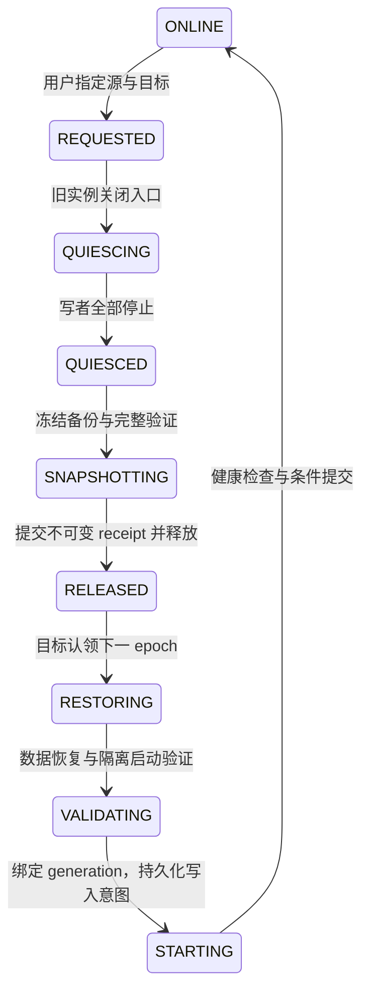

# 架构与状态

服务器只有一个 Go 模块、一个 `matrix-admin` 可执行程序。不同 systemd unit
调用它的不同子命令；长时间备份与恢复不会阻塞控制守卫。restic 是固定版本的
外部存储依赖，Docker/SQLite/nginx/systemd 是主机依赖，不是第二套业务实现。

| Go 包 | 职责 |
| --- | --- |
| internal/control | R2 条件更新、epoch、本地 journal、停止写者、入口守卫 |
| internal/mailbox | 管理命令去重、轮询、实例报告 |
| internal/engine | 准备、快照、上传、恢复、切换及升级编排 |
| internal/storage | 有界 SigV4 请求，包括空请求体哈希和条件写入 |
| internal/payload | 配置胶囊、数据库清单、路径及哈希校验 |
| internal/release | 固定 Release 下载、完整包清单校验、构建身份 |
| internal/local | 私密文件、原子持久化、进程锁、字面量配置解析 |

Worker 保留 JavaScript，负责 Access、网页、R2 状态展示和操作请求；不会执行
数据库恢复。协议版本与程序版本分别管理，实例报告包含运行程序实际的版本、提交及支持的数据协议；管理界面展示该观测。
服务端及 Worker 必须拒绝不支持的
协议，不能仅凭“版本更新”猜测格式兼容。

## 存储分工

R2 保存配置胶囊、恢复点、仓库凭据和控制状态。B2 只保存 restic 数据库快照，
包括 Tuwunel RocksDB 与 Telegram SQLite。媒体正文继续在 Tuwunel 的 S3
后端，恢复复用原 bucket/prefix。公开 GitHub 只保存工具与运行包。

本机 `/opt/matrix/config/s3.env` 是唯一用户输入。`agent/host.json` 是 Agent
确认的本机路径，`agent/runtime.json` 指向生效版本。`deploy/control` 保存
实例身份和 journal；`generations` 保存恢复的数据、配置与校验记录。
`releases/X.Y.Z` 保存完整程序，generation 不复制程序或安装脚本。

## 备份提交

在线备份获取原生 checkpoint 与 SQLite backup API 快照。二者各自一致，但
不是跨数据库事务。restic 去重上传数据库；每日至少一次完整回读、全文件哈希
与 SQLite 校验，其余执行远端清单核对。恢复点发布前验证公开工具可获取，
依次上传不可变依赖、恢复点，再以 ETag 条件写 latest，最后记录本地成功。
任一步失败保留 pending 和既有成功记录；同 run ID 重试不重复建立快照。

最终备份关闭入口、停止 Telegram 与 Tuwunel，核实干净退出和容器身份，再
复制冻结数据库。完整回读后，在 `--network none` 容器中启动数据库验证，
生成绑定 operation/instance/epoch 的 receipt。最终备份不擅自修改 latest。

## 常规交接

本地 phase 与远端 phase 是两个日志，并非必须同名；最终备份还有 DRAINING、
STOPPING、FROZEN、READY 等局部阶段。守卫只允许新鲜 R2 授权、正确 epoch、
匹配容器/挂载且健康的 owner 服务。R2 不可达超过有效期则关闭入口并停止写者。
DNS 切换不证明旧实例已停止，Telegram 后台也不依赖 HTTP 流量。

任何启动意图写入后，目标数据库可能已有新消息，禁止重放恢复覆盖它。旧 owner
在 RELEASED 后不得自行恢复；释放前可通过显式 source-resume 撤销。失联节点
不能仅凭心跳判死并接管。当前未实现强制接管与自动删除旧数据。

## 更新与故障

代码升级与数据恢复是不同命令。升级须先停止服务，保存实例和 journal，复制
经校验的新包，更新 units，再启动处于 blocked 状态的守卫。成功后由显式
resume 恢复当前 owner。pending-update 绑定版本和实例，断点重试不能换包。

新程序直接读取支持的数据协议（当前 recovery v2）；快照中的 producer 版本
仅供溯源，不触发下载并执行旧软件。未知数据格式、目录、文件、镜像身份和
校验错误均拒绝继续，不猜测兼容性。

测试覆盖守卫状态机、条件写入、命令去重、真实 SQLite WAL、restic 临时仓库
及故障注入；不把这些等同于已完成跨 VPS 的生产切换演练。
