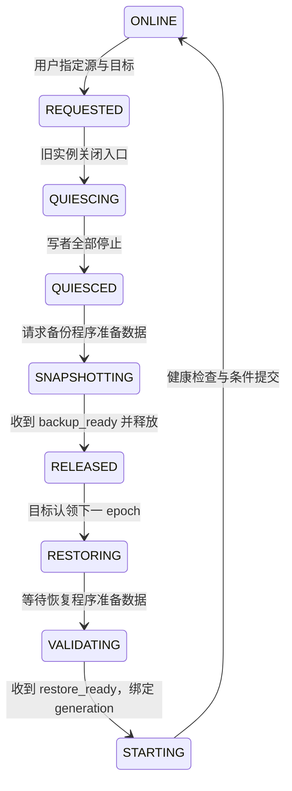

# 架构与状态

服务器只有一个 Go 模块、一个 `matrix-admin` 可执行程序。不同 systemd unit
调用它的不同子命令；长时间备份与恢复不会阻塞控制守卫。restic 是固定版本的
外部存储依赖，Docker/SQLite/nginx/systemd 是主机依赖，不是第二套业务实现。

| Go 包 | 职责 |
| --- | --- |
| internal/control | R2 条件更新、epoch、本地 journal、停止写者、入口守卫 |
| internal/management | 持久任务契约、队列、取消/重试与单调报告 |
| internal/mailbox | 管理命令去重、轮询、实例报告 |
| internal/engine | 准备、快照、上传、恢复、切换及升级编排 |
| internal/storage | 有界 SigV4 请求，包括空请求体哈希和条件写入 |
| internal/payload | 配置胶囊、数据库清单、路径及哈希校验 |
| internal/release | 固定 Release 下载、完整包清单校验、构建身份 |
| internal/local | 私密文件、原子持久化、进程锁、字面量配置解析 |

Worker 保留 JavaScript，负责 Access、网页、R2 状态展示和操作请求；不会执行
数据库恢复。协议版本与程序版本分别管理，实例报告包含运行程序实际的版本、提交及支持的数据协议；管理界面展示该观测。
服务端及 Worker 必须拒绝不支持的
协议，不能仅凭“版本更新”猜测格式兼容。

## 存储分工

R2 保存配置胶囊、恢复点、仓库凭据和控制状态。B2 只保存 restic 数据库快照，
包括 Tuwunel RocksDB 与 Telegram SQLite。媒体正文继续在 Tuwunel 的 S3
后端，恢复复用原 bucket/prefix。公开 GitHub 只保存工具与运行包。

本机 `/opt/matrix/config/s3.env` 是唯一用户输入。`agent/host.json` 是 Agent
确认的本机路径，`agent/runtime.json` 指向生效版本。`deploy/control` 保存
实例身份和 journal；`generations` 保存恢复的数据、配置与校验记录。
`releases/X.Y.Z` 保存完整程序，generation 不复制程序或安装脚本。
`agent/generations/*.json` 是本机数据目录登记表，绑定实例、恢复点、工作目录和
准入 epoch。创建恢复数据前登记，绑定前记录 epoch；清理读取同一登记表。
现有部署仅从 controller 的已绑定目录与恢复凭据登记，未知目录不会按名字猜测删除。

## 备份提交

在线备份获取原生 checkpoint 与 SQLite backup API 快照。二者各自一致，但
不是跨数据库事务。restic 增量上传数据库，并核对远端文件清单与大小。定时备份
不自动完整回读；完整回读与恢复演练只在操作者明确发起时执行。恢复点发布前验证公开工具可获取，
依次上传不可变依赖、恢复点，再以 ETag 条件写 latest，最后记录本地成功。
任一步失败保留 pending 和既有成功记录；同 run ID 重试不重复建立快照。

最终备份关闭入口、停止 Telegram 与 Tuwunel，核实干净退出和容器身份，再
在同一文件系统创建冻结数据库的硬链接视图；跨文件系统明确报错，不退回整库复制。
源机增量上传并核对快照清单后，生成绑定 operation/instance/epoch 的 schema 2 receipt。
其中 `backup_ready: true` 是备份程序给集群的就绪结果；`snapshot_verified` 与
`verification` 是诊断信息，由备份程序决定校验策略。当前生产者在上传与清单核对后提交，
不声称已完整回读或启动验证。源机不回下载数据库、不做隔离启动；最终备份不修改 latest。
目标由 restic 恢复固定快照，程序核对文件路径、类型与完整清单，成功后提交绑定恢复点
与目录的 `restore_ready`。数据块完整性由 restic 负责，不追加 `restore --verify` 或整库哈希扫描。
集群消费该结果，取得写入权后启动服务并等待健康检查；启动失败保留同一份数据供重试。
完整文件哈希、SQLite 完整性检查与 `--network none` 隔离启动只用于显式恢复演练。
旧 schema 1 已完成凭据仍可读取；新交接要求两端报告 `handover_receipt_schema: 2`，
目标重新预检。混用旧版实例时，网页、API、目标 controller 和源 worker 会阻止推进。

### 数据量与重试成本

- 源机对不可变 SST 按路径、设备、inode、大小和 mtime 缓存 SHA256；新增或变化的
  SST 才重新读内容，可变文件在制作快照清单时计算一次，上传前不重复计算。
  缓存只在本机使用，新机器重新建立。
  这是变更检测，不是磁盘坏块检查；不是每次扫描文件内容才叫增量上传。
- restic 用同一 Matrix 域名分组选择上次快照，避免最终备份工作路径改变后失去父快照。
  使用 `--ignore-ctime`，避免 checkpoint 新建硬链接触发未变化 SST 的全量重读；
  仍比较 inode、mtime、大小。首次备份、缓存缺失或表压缩重写后，相应数据仍需读取。
- 目标首次恢复必须下载所需数据库。相同操作与恢复点使用固定工作目录，restic 比较
  已下载内容，仅下载缺失或不匹配的块。重试仍可能扫描本地数据，不能承诺零 IO。
  数据传输受任务取消控制，不再用固定 90 分钟限制大库传输；元数据命令仍有限时。
- 下载、配置合并和最终 generation 共用文件。常规切换不创建测试数据库或执行恢复演练。
  显式演练的隔离启动对不可变 SST 使用硬链接，可变 RocksDB 元数据/WAL 和 SQLite
  复制到 probe；测试不能修改恢复原件。准备完成后移除下载与 probe 链接，再准入写者。
- 完成准备后先持久化 `prepared.json`，再清除临时链接、发布恢复就绪凭据。
  若在清除链接与发布之间中断，重试只补发结果，不删除已准备的 generation 或重新下载。
- 空间预检按一份数据库及 1 GiB 余量计算；显式演练才额外预留可变 probe 文件的副本。
  重试扣除已分配的下载缓存空间，稀疏文件逻辑长度不算已下载数据。数据库启动时的压缩重写、
  后续增长、Docker 镜像另需空间，这个估算不是容量上限保证。
- 交接失败写入持久暂停记录，需检查后显式继续。冻结视图重试只接受同 inode 文件；
  不创建 `interrupted-database-*` 全量副本。未完成恢复复用缓存，已绑定 generation
  拒绝再次恢复。旧流程留下的未知目录保留并报错，不能自动清理或覆盖。

硬链接依据 [RocksDB checkpoint 语义](https://github.com/facebook/rocksdb/wiki/Checkpoints)；
增量判断与续传依据 [restic 变更检测](https://restic.readthedocs.io/en/stable/040_backup.html#file-change-detection)
和 [恢复规则](https://restic.readthedocs.io/en/stable/050_restore.html)。

SQLite 快照以 backup API 成功及快照完成为准，不追加 `integrity_check`、
`foreign_key_check` 或消息/加密状态逐表计数。这些全库操作属于显式完整回读/演练。
已有恢复点携带的表计数仅在显式深度检查中使用，不作为常规切换门槛。

## 常规交接

本地 phase 与远端 phase 是两个日志，并非必须同名；最终备份还有 DRAINING、
STOPPING、FROZEN、READY 等局部阶段。守卫只允许新鲜 R2 授权、正确 epoch、
匹配容器/挂载且健康的 owner 服务。R2 不可达超过有效期则关闭入口并停止写者。
DNS 切换不证明旧实例已停止，Telegram 后台也不依赖 HTTP 流量。

任何启动意图写入后，目标数据库可能已有新消息，禁止重放恢复覆盖它。旧 owner
在 RELEASED 后不得自行恢复；释放前可通过显式 source-resume 撤销。失联节点
不能仅凭心跳判死并接管。强制接管通过显式隔离记录和固定恢复点取得新 epoch，详见下文。

启动采用持久化意图：先保存本地 STARTING 和 `may_have_written`，再 CAS 提交
远端 STARTING。若 CAS 未提交，显式继续/恢复会对同一操作、epoch、绑定目录补交
STARTING；若 CAS 已提交但回执丢失，只补本地确认。这两个边界都禁止重新恢复数据库。
远端归属变化、手动 fence 或不匹配的 generation 不能通过该路径绕过。

撤销交接是独立持久任务。它暂停并停止交接 worker，确认源仍持有原 epoch，
原子提交 ONLINE 与 `last_aborted`，随后等待源健康、恢复备份计划并清除本操作的暂停。
目标观察到撤销记录后将本地请求关闭；长时间离线错过多次撤销的未写目标，也可根据
更新的 ONLINE 权威状态关闭已提交请求。新 epoch 已完成接管后，返回的旧写者
记录为 RETIRED，保留目录与可能写入标记，始终停用。
控制器不修改 DNS，不自动删除数据。撤销任务失败可按原任务重试；归属已释放则禁止撤销。
计划切换的最终备份必须匹配仍有效的请求；撤销后晚到的 worker 不得改为独立备份再次停写。
mailbox 仅入队和上报，停止服务、等待健康等长步骤由 tasks worker 执行，
不占用 mailbox 的轮询周期。APPLIED 仅表示接收，任务终态与服务健康分别展示。

## 更新与故障

代码升级与数据恢复是不同命令。升级须先停止服务，保存实例和 journal，复制
经校验的新包，更新 units，再启动处于 blocked 状态的守卫。成功后由显式
resume 恢复当前 owner。pending-update 绑定版本和实例，断点重试不能换包。

新程序直接读取支持的数据协议（当前 recovery v2）；快照中的 producer 版本
仅供溯源，不触发下载并执行旧软件。未知数据格式、目录、文件、镜像身份和
校验错误均拒绝继续，不猜测兼容性。

测试覆盖守卫状态机、条件写入、命令去重、真实 SQLite WAL、restic 临时仓库
及故障注入；不把这些等同于已完成跨 VPS 的生产切换演练。

## 故障接管与维护

强制接管允许旧 owner 已离线，且允许原计划切换中途失败后选择另一台 standby。
操作者必须隔离当前 owner、原 source、原 target 中所有可能写入且不是新目标的
实例。目标先预检恢复点、依赖、B2、空间及镜像，再 CAS 把归属变为新目标和
下一 epoch，进入 RESTORING → VALIDATING → STARTING → ONLINE。
它不会伪造干净停机证明，也不把旧在线备份标为跨数据库一致。CAS 回应丢失时按
同一操作 ID 对账，不重复增加 epoch。STARTING 后只允许修复当前数据，不覆盖恢复。

计划切换前要求目标最近 10 分钟的预检通过；失败重检立即撤销旧 ready 结果。
恢复时重新按最终快照大小核算空间。备用 nginx 只在入口关闭时更新，校验失败
恢复原配置。暂停记录跨重启保留，作用于切换 worker，不回滚已完成状态。

任务 worker 与 mailbox、controller 是独立进程。QUEUED → RUNNING →
SUCCEEDED / FAILED / CANCELLED / INTERRUPTED，任务结果和阶段持久化并报告 R2。
RUNNING 的进程消失时标记 INTERRUPTED，需显式重试。升级关键安装阶段不取消；
它不依赖 controller unit，避免重启守卫时杀死升级进程。失败尝试恢复管理通道，
业务保持 fenced，pending-update 用于同版本续跑。

备份保留计划按时间/数量保护点，执行前再次核对 latest、当前/已完成交接及活跃
恢复任务。执行要求停用 owner，CAS 进入 MAINTENANCE，阻止新恢复和业务启动。
先写不可变 retired 标记，再 forget 指定快照、prune、check。中断保持维护态；
可重试原任务，或通过仓库校验后结束维护，再单独恢复服务。媒体不在清理范围。
旧机清理必须审阅具体目录，替代实例有新鲜 ONLINE/serving 报告且旧机已停用。
没有基于心跳超时的自动选主、自动更新或自动删除。

## 失败与人工介入

`BackupService` 是交接编排与数据工作的接口。备份程序独立负责数据传输、重试、
校验及结果持久化；同一个 Go 运行包承载这些职责，并不增加部署依赖。集群仍负责
停写证明、操作和 epoch 绑定、CAS、服务启动与健康，不把“就绪”当作绕过归属的授权。

切换页直接展示原始失败阶段、时间、原因和私密日志编号。中断单独记录，不能
覆盖首次失败；原始命令输出只保存在服务器私密日志，R2 只接收分类原因和引用。
归属释放前可暂停、继续或撤销并恢复源；撤销先停止长任务，然后通过控制器 CAS
恢复源服务。目标的等待请求单独取消，入口须切回源。归属释放后禁用直接回退，
只能继续目标或在外部隔离后强制接管。切换未完成不能清理；完成后仍须审阅清理计划。
